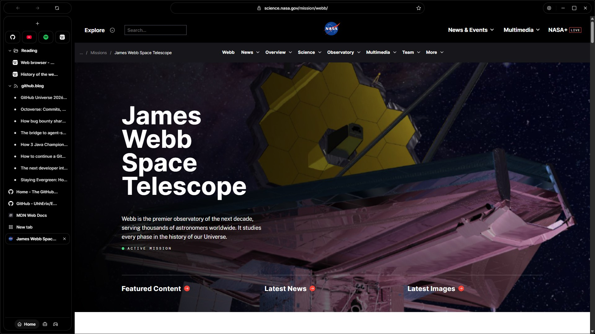
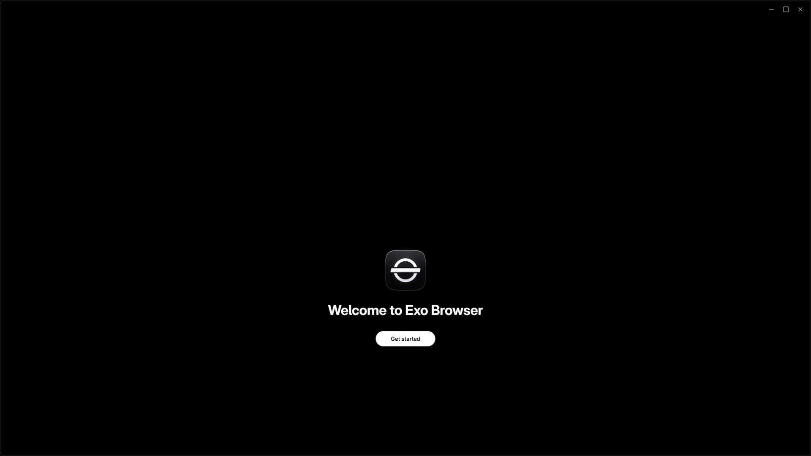
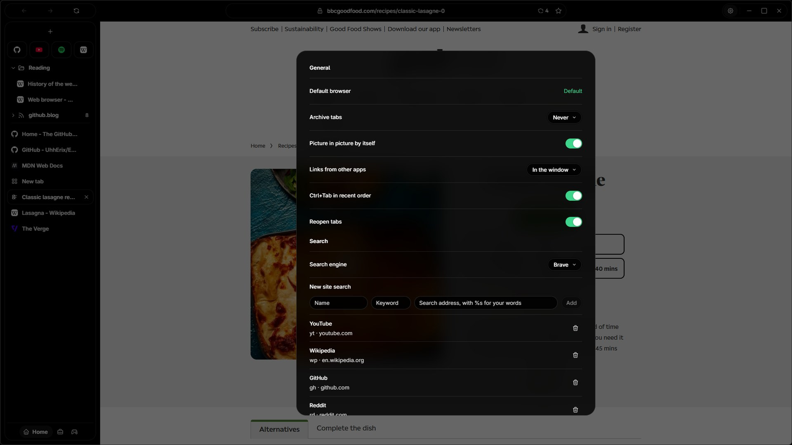
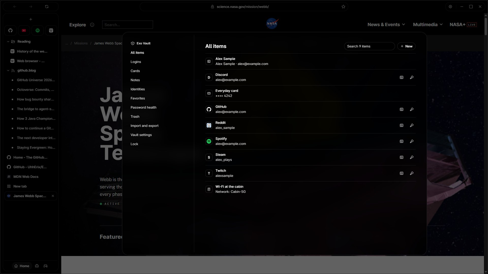
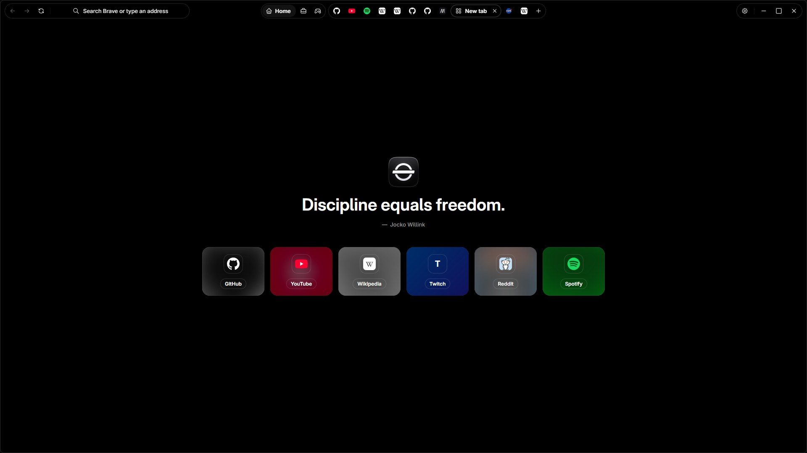
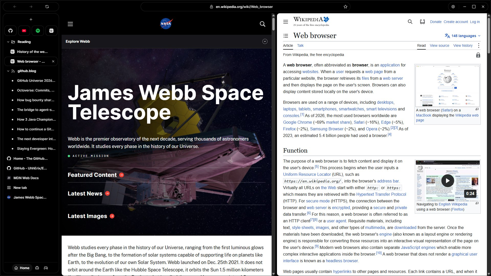
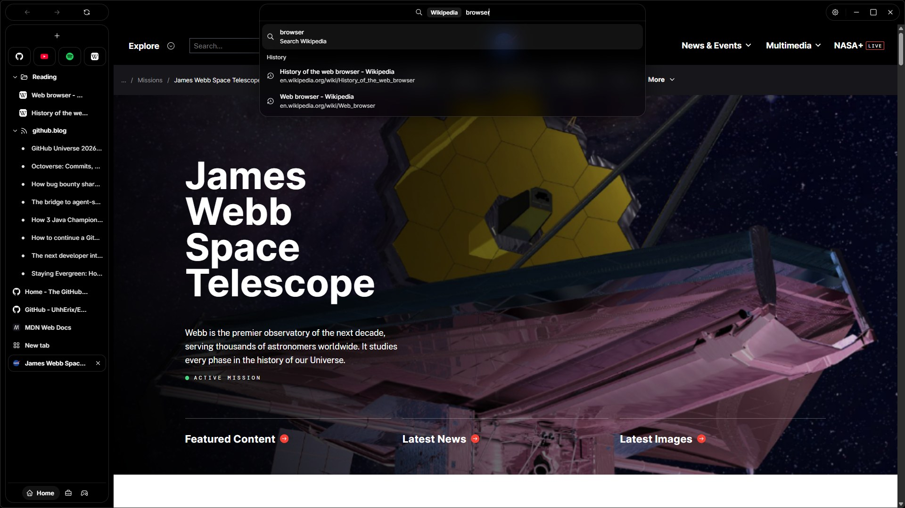
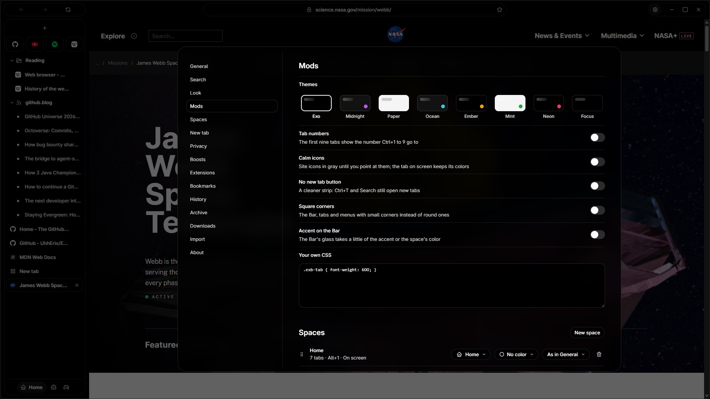

<p align="center"></p>
<h1 align="center">Exo Browser</h1>
<p align="center"><strong>A private, fast browser for Windows 11, with ad blocking and a password vault built in.</strong></p>

<p align="center">
  <a href="https://github.com/UhhErix/ExoBrowser/releases/latest/download/ExoBrowser-Setup.exe"><strong>Download for Windows 11</strong></a>
  · <a href="https://github.com/UhhErix/ExoBrowser/releases/tag/v1.1.2">What's new in 1.1.2</a>
  · <a href="CHANGELOG.md">Changelog</a>
  · <a href="PRIVACY.md">Privacy</a>
  · <a href="SECURITY.md">Security</a>
  · <a href="LICENSE">License</a>
</p>



## Download

| File | Version | SHA-256 |
| --- | --- | --- |
| [ExoBrowser-Setup.exe](https://github.com/UhhErix/ExoBrowser/releases/download/v1.1.2/ExoBrowser-Setup.exe) | 1.1.2 | `1312066487ea8089ec630bb0615215bcbcc414a57092a196ea9128493fe7ae47` |

**Requirements:** Windows 11 x64 with WebView2 (built into Windows 11; Setup installs it if it's missing). Installs for your Windows user only, in `%LOCALAPPDATA%\ExoBrowser\app`, with no administrator rights.

**Check your download.** The installer isn't code-signed yet, so Windows SmartScreen may warn the first time (choose **More info**, then **Run anyway**). Before you run it, check that its hash matches the one above and on the [release page](https://github.com/UhhErix/ExoBrowser/releases/tag/v1.1.2):

```powershell
Get-FileHash .\ExoBrowser-Setup.exe -Algorithm SHA256
```

## Install

1. Download **ExoBrowser-Setup.exe** (above) and check its hash.
2. Run it, choose **Install**, then **Launch Exo Browser**. First run sets up Exo Vault, brings your things over from your other browsers, picks your look and offers to make Exo Browser your default browser. Every step can be skipped and changed later.
3. New versions show in **Settings > About**. **Install update** downloads it, checks it and installs it over the one you have; your tabs, history, sign-ins and vault stay.



## What's built in

- **Exo Shield:** ads, trackers, malware, cookie notices and pop-ups blocked before they load, on every site, always on. YouTube ads are blocked like any other; for Twitch, which puts ads inside the stream, Exo Shield asks for each stream from a country Twitch shows no ads in, and the video still comes straight from Twitch.
- **Exo Vault:** logins, cards, notes and identities encrypted on this PC, with no account and no cloud. It fills sign-in forms, makes strong passwords, shows 2FA codes and opens with Windows Hello.
- **Tabs that stay in order:** spaces, favorites, pinned tabs in folders, live folders and an optional archive.
- **Private by default:** address lookups go encrypted to Cloudflare, Microsoft Edge's balanced tracking prevention is on, private tabs keep nothing, and there's no Exo account, no ads and no telemetry.
- **Exo Launcher's look:** Light, Dark or Void (pure black, for OLED), Liquid Glass or solid, one-click themes, and tabs across the top or down the side.
- **Easy to move in:** one click brings bookmarks, history, sign-ins, extensions and passwords from the other browsers on this PC, and Arc's spaces, favorites and folders from its files.

## Exo Shield



Exo Shield blocks before anything loads, on every site:

- **Ads and trackers:** uBlock Origin Lite's filters with complete filtering everywhere (the extension's strongest mode), plus HaGeZi's Multi PRO list of about 200,000 ad, tracking and malware sites.
- **Annoyances:** cookie notices, overlays, notification prompts, chat and social widgets, and tracking parameters stripped from links.
- **Twitch:** TTV LOL PRO, set to send nothing about you to its developers.
- **Secure DNS:** every lookup over HTTPS to Cloudflare, with no unencrypted fallback.

It's locked on: it has no settings, can't be turned off or removed, and every start puts its rules back exactly. It runs in private tabs too. Settings > About lists its parts and when its lists were built.

**Check it yourself.** Exo Shield is uBlock Origin Lite 2026.1021.1354, TTV LOL PRO 2.6.2 and HaGeZi's Multi PRO list, merged into one extension. Its lists ship with the browser, so it fetches nothing to block. Everything it runs is in [`extensions/exo-shield`](extensions/exo-shield), built by [`tools/build-shield.mjs`](tools/build-shield.mjs), and [`NOTICE.txt`](extensions/exo-shield/NOTICE.txt) lists every change from the upstream projects. The HaGeZi ruleset in this release holds 207,507 domains ([`hagezi-pro.json`](extensions/exo-shield/hagezi-pro.json)).

## Exo Vault



A password manager in the browser, with everything kept on this PC:

- **What it keeps:** logins with 2FA codes, cards, secure notes and identities, with favorites, a trash and each login's earlier passwords.
- **Signing in:** a menu on sign-in fields fills your login, and Exo Vault offers to save a new one or update a changed one.
- **Password health:** weak passwords, passwords reused across sites, and sites that offer 2FA where you haven't set it up, all worked out on your PC.
- **Locked when you're away:** after the time you choose, when Windows locks and when the PC sleeps. A copied password leaves the clipboard after 30 seconds and never reaches Windows' clipboard history.
- **Moving in and out:** import from the browsers on this PC, or from a Proton Pass, Bitwarden, 1Password, LastPass, Dashlane, KeePass, Safari or any browser's export. Export everything as one encrypted file to open on another PC.

> [!IMPORTANT]
> Nobody can reset your master password, Exo included. Pick one you'll remember.

**How it's protected.** The vault is one file on your PC. Its key is random and never written in the clear: it's wrapped by a key derived from your master password with Argon2id (256 MiB of memory, 4 passes, 4 lanes) and, if you choose, by Windows Hello. Items are encrypted with AES-256-GCM through Windows' CNG. Each save goes to a temporary file that is swapped in, with the previous save kept as a backup. Decrypted items live only in the vault's page while it's open. The details are in [SECURITY.md](SECURITY.md), and the code is in [`src/vault.cpp`](src/vault.cpp).

## Tabs your way



- **Spaces:** each with its own tabs, icon, color and appearance. Alt+1 to 9 switch them, a tab dragged onto one moves there, and a site's links from your other apps can open in the space you pick for it.
- **Favorites and pinned tabs:** favorites show in every space. A pinned tab remembers its page, its icon takes it back when it wanders, and closing it only puts it to sleep.
- **Folders and live folders:** with tabs down the side, pinned tabs sit in folders, folders inside folders too. Right-click a site's tab and choose **Follow this site in a live folder** to see its newest posts, checked every 30 minutes.
- **Split view and Peek:** up to four tabs side by side (Ctrl+Shift+=), or Shift+click a link to read it in a card over the page and Ctrl+O to keep it as a tab.
- **Private tabs:** Ctrl+Shift+N opens a tab whose cookies and sign-ins stay apart from your other tabs and are gone when the last private tab closes. Nothing it visits reaches your history.
- **Ctrl+Tab in the order you used tabs,** as Alt+Tab does with windows.
- **Archive tabs** (off by default) closes tabs you haven't opened in a while into an archive that Search still finds.
- **Little Exo:** links from your other apps can open in a small window of their own; Ctrl+O moves one into your tabs.



## Search



One field for everything: an address opens, anything else goes to your search engine (Brave Search unless you pick another). Suggestions come from your tabs, bookmarks and history on this PC; nothing is sent while you type.

- **Search one site:** type its keyword and a space ("yt cats" searches YouTube), or its address and Tab. **Settings > Search** keeps the list and adds your own.
- **Everything at once:** **Ctrl+K** finds a tab, bookmark, page from your history or one of the browser's actions.
- **Clean links:** every page opens without the tracking parts that share buttons and ads add to its address (`utm_` tags, click ids), whether you click it, paste it or it comes from another app, and **Ctrl+Shift+C** or a link's **Copy link** copies it the same way.

## Make it yours



- **Look:** Light, Dark or Void, Liquid Glass or solid, an accent color, a compact Bar, tab size, text size and reduced motion.
- **Mods:** eight one-click themes, small tweaks (tab numbers, calm icons, no new tab button, square corners, the accent on the Bar) and your own CSS for Exo Browser itself.
- **Boosts:** right-click a tab to zap things off a site's pages for good, or give a site your own style. **Settings > Boosts** lists them, each with a switch.

## How it works

Exo Browser is a native Windows app (C++) built on Microsoft Edge WebView2, the Chromium engine that comes with Windows and that Windows keeps up to date. Pages render as they do in Edge and Chrome, and Chrome Web Store extensions work.

- **Its own interface:** the Bar, new tab page, Settings and Exo Vault are Exo Browser's own pages, in their own profile with no extensions and no access to the web.
- **Exo Shield** and **Exo Vault** work as described above.
- **Building it:** [docs/DEVELOPING.md](docs/DEVELOPING.md) says how the source fits together and how to build it.

## Privacy and safety

- **No Exo account, no ads, no analytics, no telemetry.** Exo Browser has no server of its own. Your history, bookmarks, spaces, settings and vault stay in `%LocalAppData%\ExoBrowser`.
- **What leaves your PC** is what browsing needs: the sites you open, your address lookups (to Cloudflare), your searches (to the engine or site you pick), the feeds of sites you follow in live folders, the Twitch playlist requests Exo Shield routes, Chrome Web Store downloads when you add an extension, and the update check to GitHub. The [privacy policy](PRIVACY.md) lists every destination and what is sent.
- **Your passwords never leave this PC** unless you export them, and an export is encrypted with a password you choose.
- **Found a security problem?** Please [report it privately](https://github.com/UhhErix/ExoBrowser/security/advisories/new), not in a public issue. See [SECURITY.md](SECURITY.md).

## Contributing

Bug reports, fixes and clearer wording are welcome. Read [CONTRIBUTING.md](CONTRIBUTING.md) first: it explains what you agree to when you send a change, since Exo Browser isn't open source.

## License

Exo Browser is **source-available and free for personal use**. It is not open source. The full terms are in [LICENSE](LICENSE); this is a plain summary, and LICENSE wins if they differ.

| You can | You need written permission to |
| --- | --- |
| Download, install and run the official app on your devices | Copy, fork outside GitHub, mirror or redistribute the source |
| Read the source to see what Exo Browser does | Publish, sell or rebrand a changed version |
| Build it and run it on your own devices to check it against the release | |
| Send fixes as pull requests ([CONTRIBUTING.md](CONTRIBUTING.md)) | |

To ask for permission, [open an issue](https://github.com/UhhErix/ExoBrowser/issues). The app is provided as is, without warranty, including for the loss of passwords or other data kept in Exo Vault.

**Open-source parts that ship with Exo Browser** keep their own licenses, and their source is public:

- [Exo Shield](https://github.com/UhhErix/exo-shield) (GPL-3.0), made from uBlock Origin Lite, HaGeZi's DNS blocklists and TTV LOL PRO.
- Argon2 (CC0), for Exo Vault's key.

Every bundled library, font and tool is listed in [Third-party notices](THIRD_PARTY_NOTICES.md).

**Not affiliated.** Exo Browser is independent and not affiliated with or endorsed by Microsoft, Google, Cloudflare, Twitch, YouTube, The Browser Company (Arc), the uBlock Origin, HaGeZi or TTV LOL PRO projects, or any password manager or website it works with. Their names and logos belong to their owners, as do the pages of NASA, Wikipedia and GitHub in the pictures above. Your use of each site and service stays under its own terms.

---

[Help](docs/HELP.md) · [Report an issue](https://github.com/UhhErix/ExoBrowser/issues) · [Support development](https://www.buymeacoffee.com/UhhErix)

© 2026 Erix ([UhhErix](https://github.com/UhhErix)).
